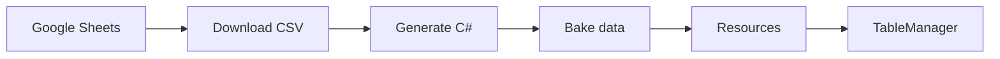

> For AI agents: the complete documentation index is available at /AchEngine/ja/llms.txt, the full documentation bundle is available at /AchEngine/ja/llms-full.txt.

# Table Loader — 概要

Table Loader は Google Sheets のデータを CSV として取得し、C# 型を生成してランタイムデータへベイクします。

> **オプションパッケージ**
> 
> `com.cysharp.memorypack` があれば `.bytes`、なければ JSON を使用します。
> 

主な設定は Spreadsheet ID、CSV・コード・バイナリ出力パス、シート名/GID/クラス名、処理の自動化です。

## 次のステップ

- [設定とダウンロード](/AchEngine/ja/usage/table/setup.md)
- [JSON → CSV](/AchEngine/ja/usage/table/json-to-csv.md)
- [コード生成とランタイム](/AchEngine/ja/usage/table/codegen.md)
