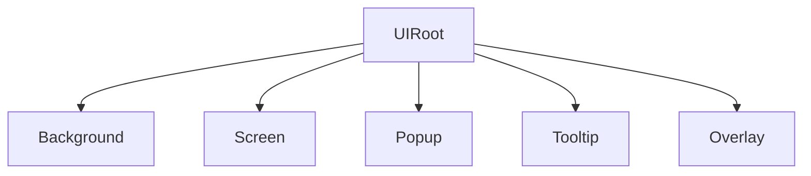

> For AI agents: the complete documentation index is available at /AchEngine/ja/llms.txt, the full documentation bundle is available at /AchEngine/ja/llms-full.txt.

# UI システム — 概要

AchEngine UI はレイヤー別 View 管理、プール、トランジション、バインディング、エディター支援を提供します。

| コンポーネント                          | 役割                   |
| -------------------------------- | -------------------- |
| `UIRoot`                         | UI レイヤーと Catalog を管理 |
| `UIView`                         | 画面とポップアップの基底クラス      |
| `UIViewCatalog`                  | ID とプレハブ・設定の対応       |
| `UIBootstrapper`                 | 起動時に View を開く        |
| `UIOpenButton` / `UICloseButton` | Inspector ナビゲーション    |
| `UISafeAreaFitter`               | ノッチ領域を回避             |



```csharp
var ui = ServiceLocator.Resolve<IUIService>();
ui.Show<MainMenuView>();
ui.Show("SettingsPopup");
ui.Close<MainMenuView>();
ui.CloseAll();
```

## 次のステップ

- [UIView とライフサイクル](/AchEngine/ja/usage/ui/views.md)
- [UI Workspace](/AchEngine/ja/usage/ui/workspace.md)
