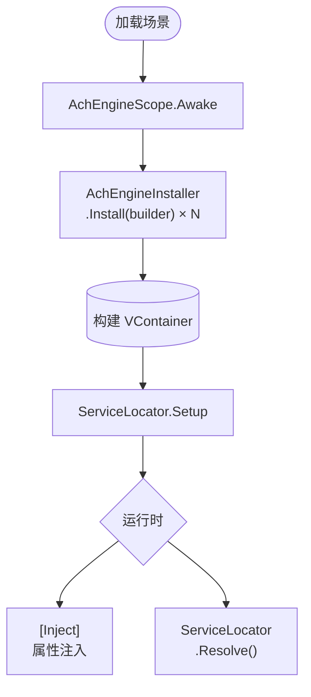

> For AI agents: the complete documentation index is available at /AchEngine/zh/llms.txt, the full documentation bundle is available at /AchEngine/zh/llms-full.txt.

# DI 系统 — 概览

AchEngine 提供简单的 DI 抽象层，不直接暴露 VContainer。


> **可选模块**
> 
> 只有安装 `jp.hadashikick.vcontainer` 时才启用实际容器。未安装时仍可手动配置 `ServiceLocator`。
> 


## 核心组件

| 类型                   | 作用                                  |
| -------------------- | ----------------------------------- |
| `AchEngineScope`     | 封装 VContainer `LifetimeScope` 的场景入口 |
| `AchEngineInstaller` | 定义服务注册的基类                           |
| `IServiceBuilder`    | 不依赖 VContainer 的注册接口                |
| `ServiceLocator`     | 运行时解析服务的静态门面                        |

## 基本流程



## `ServiceLifetime`

```csharp
public enum ServiceLifetime
{
    Singleton, // 每个容器一个实例
    Transient, // 每次请求创建新实例
    Scoped,    // 每个作用域一个实例
}
```

## 下一步

- [AchEngineInstaller](/AchEngine/zh/usage/di/installer.md)
- [ServiceLocator](/AchEngine/zh/usage/di/locator.md)
- [DI 生命周期](/AchEngine/zh/usage/di/lifecycle.md)
